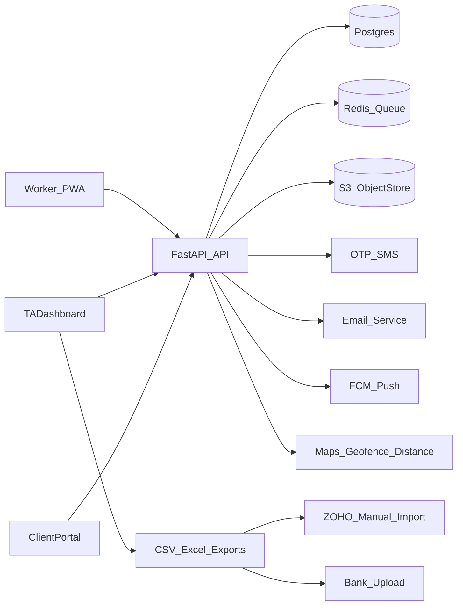

## Scope (MVP per PRD)

- **Personas/roles**: Worker, TalentAcquisition (TA), EmployerClient, Admin.
- **Core lifecycle**: Worker onboarding → JobOrder creation → Matching+Dispatch → Shift scheduling → GPS+photo attendance → Timesheets (client endorse, TA verify) → Payroll calc → Payment instruction export + ZOHO CSV exports.
- **Explicitly out-of-scope**: native mobile apps, live ZOHO API sync, WhatsApp API, direct banking payouts, Singpass MyInfo.

## Assumptions (based on PRD + your answers)

- Workspace is currently empty; we’ll scaffold a new repo.
- We will follow the PRD recommended stack (React/TS/Tailwind PWA + FastAPI + Postgres + Redis + S3 + FCM + SendGrid/SES + Twilio/SNS + Maps).
- You have ZOHO import templates/field mappings; plan includes implementing exporters once templates are provided.

## Target architecture

- **Frontend** (single repo, multi-app routing):
  - WorkerApp (mobile-first PWA)
  - TADashboard (desktop-first)
  - ClientPortal (desktop-first)
- **Backend**: FastAPI monolith with modular domains (auth, workers, jobs, matching, scheduling, attendance, timesheets, payroll, exports, notifications, audit).
- **Data**: Postgres for core entities; Redis for queues/caching (matching + notifications + scheduled reminders).
- **Files**: S3-compatible object store for documents + attendance photos (private; served via signed URLs).

## Repository structure (proposed)

- `[backend/](backend/)`
  - `app/main.py` (FastAPI bootstrap)
  - `app/config.py` (env + settings)
  - `app/db/` (SQLAlchemy/SQLModel + Alembic migrations)
  - `app/auth/` (JWT + RBAC + OTP)
  - `app/domains/{workers,clients,job_orders,shifts,attendance,timesheets,payroll,matching,notifications,exports,audit}/`
  - `tests/`
- `[frontend/](frontend/)`
  - `src/app/` (router + layouts per role)
  - `src/features/` (marketplace, job_orders, shifts, attendance, timesheets, payroll, analytics)
  - `src/i18n/` (EN/ZH translations)
  - `src/components/` (design system)
- `[infra/](infra/)`
  - `docker-compose.yml` (local Postgres+Redis)
  - `Dockerfile`(s) + deployment notes

## Data model (MVP)

- **Users**: `User(id, role, email?, phone, hashed_password?, otp_state, locale, created_at)`
- **Workers**: profile + compliance docs + tier + status + preferences + location.
- **Clients**: employer accounts + users + job sites.
- **JobOrders**: requirements, pay model, geofence radius, dispatch mode, status.
- **Shifts**: job_order_id, start/end, worker assignment, waitlist state.
- **AttendanceRecords**: clock_in/out photos+gps+timestamps, geofence validity, computed hours.
- **TimesheetEntries**: derived from attendance, endorsement/verification workflow + disputes.
- **Payments**: grouped per worker per pay run; instruction file metadata; audit trail.
- **Ratings**: per shift by client; aggregates into worker rating avg.
- **AuditLog**: append-only “who changed what when” for PDPA + payroll traceability.

## Key workflows to implement

- **Onboarding**: OTP sign-in → profile wizard → document upload → profile completeness.
- **JobOrder**: client submit (and TA create) → validate → create multi-day/multi-shift schedule.
- **Matching**: eligibility filter (status, conflicts, docs/certs, availability) → score (proximity, rating, type match, completion rate, tier) → ranked list.
- **Dispatch**: FCFS vs PerformancePriority vs PreferredPriority with configurable windows; waitlist.
- **Attendance**: clock-in/out with photo; geofence validation; exceptions + no-show auto-flag.
- **Timesheets**: generate from attendance; client endorse; TA verify; lock on verified; disputes.
- **Payroll**: compute pay models + overtime; generate payment instruction file; notify workers.
- **Exports**: ZOHO CSV/Excel for JobOrders/Timesheets/Payroll using your templates.

## Security/compliance requirements (MVP)

- **RBAC**: strict per-role access; per-client tenant isolation.
- **PII**: encrypt sensitive fields at rest (NRIC masked + encrypted raw, bank acct encrypted), private file storage, signed URLs.
- **Auditability**: immutable audit log for approvals, disputes, payroll releases.
- **PDPA**: consent capture, retention policy, deletion request workflow (admin-only).

## Delivery plan (3 sprints / ~6 weeks, aligned to PRD)

### Sprint_1 — Foundation + Core auth + Worker profile + Job order creation

- Scaffold repo + local dev (Docker compose: Postgres+Redis).
- Backend: JWT+RBAC, OTP login/registration, base schemas, audit log.
- Worker: registration, profile wizard, document upload, i18n (EN/ZH).
- TA: create JobOrder + shift templates (multi-day/multi-shift).

### Sprint_2 — Matching + Dispatch + Scheduling + Attendance

- Matching engine (eligibility + scoring + per-job-type weights).
- Worker marketplace feed + apply/accept/decline; waitlist; de-prioritization on no response.
- Notifications: push/email for broadcast + confirmations + reminders.
- Attendance: clock-in/out photo + GPS; geofence validation; exception flags; no-show automation.

### Sprint_3 — Timesheets + Payroll + Client portal + Analytics + Exports + Polish

- Client portal: job tracking, roster view, preferred workers, live attendance view.
- Timesheets: auto-generate, client endorse, TA verify, disputes.
- Payroll: pay models + overtime; payment instruction generation.
- Analytics dashboards + worker ratings/tier + recommendations.
- ZOHO exports implemented against your provided templates; end-to-end demo seed + UAT.

## Test plan (what we’ll validate as we build)

- **Unit tests**: matching scoring, shift conflict detection, geofence checks, payroll calculations.
- **Integration tests**: endorsement/verification state machine; export file generation.
- **E2E smoke**: worker onboarding → accept shift → clock in/out → timesheet approve → payroll export.

## Risks to plan for (from PRD)

- Geofence accuracy: support configurable radius + TA override and clear “flagged” flows.
- Export mapping: implement exporters after confirming your ZOHO templates; add golden-file tests.
- Low digital literacy: step-by-step mobile flows, large tap targets, simplified copy, bilingual.

