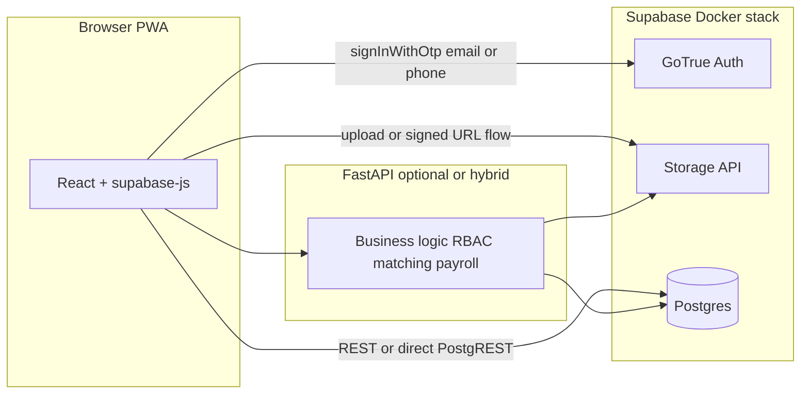

# Worker mobile onboarding + Supabase (Docker): Auth, Storage, DB

This plan replaces the earlier “Postgres only + FastAPI OTP + local files” approach with **Supabase (self-hosted Docker)** as the platform for **authentication (email OTP + phone OTP)**, **document storage**, and **Postgres** for all **application tables** (worker profiles, job data, audit, etc.).

---

## Architecture (target)

**Principles:**

- **Identity:** Supabase `**auth.users`** is the source of truth for sign-in. Email OTP and phone (SMS) OTP use **Supabase Auth** (`signInWithOtp`), not custom Redis OTP or FastAPI `/auth/otp/*` for workers (those endpoints can be retired or limited to non-Supabase roles if TA/client stay on legacy auth temporarily—product choice: **worker-only Supabase first** is simplest).
- **Documents:** Files live in **Supabase Storage** (bucket, e.g. `worker-documents`), with **RLS policies** tying objects to `auth.uid()`. The app keeps a `**documents`** (or equivalent) **row in Postgres** storing `user_id` / `worker_profile_id`, `doc_type`, `storage_path` or bucket+object key, timestamps—no long-term reliance on `[upload_dir](backend/app/config.py)` / local `[StaticFiles](backend/app/main.py)` for worker onboarding docs.
- **Tables:** All **domain tables** (worker profiles, shifts, job orders, etc.) live in **the same Supabase Postgres** (`public` schema or namespaced). Continue **Alembic** (or **Supabase migrations**) against that instance; align foreign keys with `**auth.users.id` (UUID)** instead of an app-only integer `users.id`, **or** add a thin `public.app_users` row keyed by `auth_user_id uuid` unique—pick one model and migrate consistently.

---

## Infrastructure: Supabase Docker

**Current state:** `[infra/docker-compose.yml](infra/docker-compose.yml)` uses standalone `postgres:16-alpine` and FastAPI env `DATABASE_URL` pointing at it.

**Target state:**

- Run the **official Supabase self-hosted Docker** bundle ([Self-hosting with Docker](https://supabase.com/docs/guides/self-hosting/docker)) under e.g. `infra/supabase/` with generated `.env` (secrets, JWT, SMTP placeholders, SMS provider keys).
- **Remove** the standalone `postgres` service from the app compose; `**api` / `web`** join the same Docker network as Supabase (or document `host.docker.internal` for hybrid CLI workflows).
- **Configure GoTrue (Auth):**
  - **Email OTP / magic link:** SMTP (e.g. **Inbucket** or Mailpit in dev for self-hosted; real SMTP in prod).
  - **Phone OTP (MVP / for now):** Use a **fixed code `123456`** for any phone number—no real SMS in this phase. Supabase GoTrue does not ship this out of the box; at implementation time choose the **smallest viable** approach, e.g. a **dev-only** [Auth hook](https://supabase.com/docs/guides/auth/auth-hooks) (or self-hosted equivalent) that accepts `123456`, or a **temporary** custom verify path that still results in a normal Supabase session. Document clearly that `**123456` is not acceptable for production** and must be replaced with a real SMS provider + real OTP before go-live.

**Redis:** Re-evaluate per feature—**OTP moves off Redis** for Supabase Auth flows. Keep Redis only if still needed (queues, rate limits, sessions elsewhere).

---

## Frontend (worker onboarding + auth)

- Add `**@supabase/supabase-js`**; `VITE_SUPABASE_URL` + `VITE_SUPABASE_ANON_KEY` (from Supabase dashboard / self-hosted `.env`).
- **Welcome + language** unchanged UX-wise; **sign-up / sign-in:** call `supabase.auth.signInWithOtp({ email, options: { shouldCreateUser: true } })` and `signInWithOtp({ phone })` per product rules; poll or deep-link for email; phone flow uses **OTP `123456`** in the MVP (show a small dev hint in UI optional).
- After session is established, **onboarding** reads/writes:
  - **Profile / progress:** either **PostgREST** (if you expose tables with RLS) or **FastAPI** with JWT validated as Supabase-issued (see below).
  - **Documents:** `supabase.storage.from('worker-documents').upload(...)` with progress; enforce client-side type/size; mirror metadata in Postgres via API or RPC.
- **Mobile shell + weighted progress bar + i18n + autosave** remain as in the UX spec (20/20/15/35/10, sticky bar, EN/ZH, masking, review, terms).

---

## Backend (FastAPI) role

Two supported patterns (choose one in implementation; hybrid is possible during migration):

1. **BFF / domain API:** FastAPI verifies **Supabase JWT** (JWKS or shared secret from Supabase JWT config) on `Authorization: Bearer`, resolves `sub` = `auth.users.id`, runs business logic (matching, payroll, TA tools), reads/writes Postgres with **service role** or **user-scoped** DB user—avoid duplicating Auth.
2. **Gradual:** Workers use Supabase for auth + storage + some RLS tables; TA/client remain on legacy JWT until migrated.

**Deprecate** for workers: `[backend/app/routers/auth.py](backend/app/routers/auth.py)` OTP request/verify for phone-only signup **once** Supabase Auth is live for workers.

**Documents API:** Replace or wrap `[upload_document](backend/app/routers/workers.py)` local disk write with **Storage upload** (server-side service role) **or** drop upload route and use **client → Storage** only + API to register metadata row.

**Schema:** Migrations must add UUID linkage to Auth, Storage paths on `Document` model, and **weighted `profile_completeness_pct`** logic (and optional `bank_name`, `onboarding_completed_at`, etc.) as before.

---

## Security / compliance (brief)

- **RLS:** Enable on `public` tables that the client touches directly; policies on `auth.uid()`. Service role for admin/export paths only on server.
- **Storage policies:** Per-user prefix `auth.uid()/...` or worker_id validated via join.
- **PII:** Keep encryption/masking strategy for NRIC/bank in Postgres columns; files in Storage are **private** bucket, no public URLs without signed URLs.

---

## Suggested implementation order

1. **Supabase Docker** — Stack up, Studio reachable, SMTP/SMS config documented for dev.
2. **Database** — Point Alembic at Supabase Postgres; migrate `users` → `auth.users` + profile tables with UUID FKs (or mapping table); add Storage metadata columns.
3. **Auth path** — Frontend Supabase OTP (email + phone with `**123456`** mock until real SMS); retire worker FastAPI OTP.
4. **Storage** — Bucket + policies; wire onboarding uploads + metadata.
5. **Onboarding UI** — Shell, steps, progress, i18n, autosave.
6. **FastAPI** — JWT validation, remaining endpoints, TA/client if still on legacy.

---

## Todos

- Add Supabase self-hosted Docker (`infra/supabase` or docs + network link); remove standalone `postgres` from `[infra/docker-compose.yml](infra/docker-compose.yml)`; update env samples.
- Migrate schema: `auth.users` UUID linkage, documents referencing Storage, completeness/onboarding fields.
- Frontend: `supabase-js`, email + phone OTP flows (**phone code `123456`** for now), Storage uploads for worker docs.
- Backend: Supabase JWT verification, Storage-backed (or metadata-only) document flow, remove worker Redis OTP when replaced.
- Worker onboarding UI: mobile shell, weighted progress, validation, review, terms, EN/ZH.

